<h1 align="center">Commerce Agent Protocol</h1>

<p align="center">
  <strong>Make your catalog readable, rankable and buyable by AI shopping agents.</strong><br/>
  Agent-readiness scoring and catalog quality for UCP, Shopify Catalog, ChatGPT and Gemini. Open source, Apache-2.0.
</p>

<p align="center">
  
</p>

<p align="center">
  <a href="https://github.com/teocomyn/commerce-agent-protocol/blob/main/LICENSE"></a>
  <a href="https://github.com/teocomyn/commerce-agent-protocol/actions/workflows/ci.yml"></a>
  <a href="https://github.com/teocomyn/commerce-agent-protocol/issues"></a>
  <a href="https://github.com/teocomyn/commerce-agent-protocol/stargazers"></a>
  <a href="https://github.com/teocomyn/commerce-agent-protocol/releases"></a>
</p>

---

## Why CAP?

Today, when an AI shopping agent reads a store, it gets what the storefront exposes: a title, a price, a few lines of description. Agents need thirty or more structured attributes to rank and recommend a product; most catalogs expose three to eight. The checkout rails now exist (Google and Shopify's UCP, Shopify Catalog, ChatGPT and Gemini shopping). The data they read is still poor.

**CAP measures and fixes that.** It ingests a merchant's catalog, enriches each product into typed attributes, scores how ready it is for agents and exposes the result the way an agent reads it, so the merchant sees and fixes what the rails see. The reference implementation is free (Apache-2.0); Shopify is the only supported platform today.

> Until v0.2 CAP tried to be the checkout protocol between agents and merchants. Shopify now ships a UCP MCP per store and Google, OpenAI and Stripe own the rails, so CAP feeds them instead of competing with them. See [ADR-0001](./docs/ADR-0001-positioning-agent-readiness.md).

---

## What CAP gives you

| Pillar | What it does |
|--------|--------------|
| **1. Catalog ingestion and structured enrichment** | Shopify OAuth, bulk sync and webhooks feed a raw catalog; GPT structured output turns each product into typed attributes (materials, dimensions, certifications from merchant metafields, shipping, returns) with vector embeddings. |
| **2. Agent Readiness Score** | `computeGeoScore` rates each product and catalog on what shopping agents need to read, rank and transact it. Published weights, per-attribute fixes and calibration on real catalogs are the next milestone ([ADR-0001](./docs/ADR-0001-positioning-agent-readiness.md)). |
| **3. Agent-facing read surface** | `/v1/search` (semantic, vector) and `/v1/compare` (matrix) over REST and MCP (`commerce_search`, `commerce_compare`, same code and errors on both), used to check how an agent sees the catalog. `/v1/checkout/initiate` and `commerce_checkout` stay for compatibility and are no longer the product promise. |

This repository contains the reference implementation (this monorepo) and the original [`cap-spec/`](./cap-spec) JSON schema, kept as CAP's catalog format rather than as a standard for others to implement.

---

## Architecture

```
Shopify ──► OAuth ──► Catalog sync (BullMQ)
                          │
                          ▼
                    Postgres + pgvector ──► /v1/search (vector + filters)
                          │                  /v1/compare
                          │                  /v1/checkout/initiate (Cart API)
                          │
                          └─► MCP stdio and HTTP /mcp (commerce_search / compare / checkout)
                                         │
                                         ▼
                              Claude · ChatGPT · Perplexity · Operator
```

Diagrams: [`cap_system_architecture_overview.svg`](./cap_system_architecture_overview.svg) · [`cap_data_flow_product_to_agent.svg`](./cap_data_flow_product_to_agent.svg)

---

## Quick start

**Requirements:** Node ≥ 22.12, pnpm ≥ 9, Docker.

```bash
# 1. Local Postgres (with pgvector) + Redis
docker compose up -d

# 2. Environment
cp .env.example .env
# Fill in at minimum: DATABASE_URL, REDIS_URL, OPENAI_API_KEY, ENCRYPTION_KEY,
# and SHOPIFY_* if you connect a store. Replace every `change_me` value: processes refuse to
# start with example secrets. Generate secrets with:
openssl rand -hex 32   # ENCRYPTION_KEY, CAP_OPERATIONS_TOKEN, DASHBOARD_SESSION_SECRET

# 3. Install + DB schema
pnpm install
pnpm db:generate
pnpm db:migrate   # uses prisma migrate deploy

# 4. Run API + dashboard
pnpm dev
```

API on **`http://localhost:3000`**, dashboard on **`http://localhost:3001`**.

**Workers** (catalog sync + LLM enrichment) run as separate processes:

```bash
pnpm --filter=@cap/api dev:worker:enrichment
pnpm --filter=@cap/api dev:worker:catalog
```

**Try the API:**

```bash
# Live OpenAPI spec
curl http://localhost:3000/openapi.json | jq

# Search (after creating a CAP API key in the dashboard)
curl -X POST http://localhost:3000/v1/search \
  -H "X-CAP-Key: cap_live_..." \
  -H "Content-Type: application/json" \
  -d '{"query":"white eco-friendly sneakers under 120","limit":3}'
```

Send an `Idempotency-Key` header on `POST /v1/checkout/initiate`: a retried request with the same key and body returns the first outcome (checkout or error) instead of creating a second Shopify cart. Keys are never released; to try again after a failure, use a new key.

**Connect a remote MCP client** (Streamable HTTP, any client that can send a custom header). The same tools are served at `/mcp` of a running API; the API key decides the merchant, as on the REST endpoints. Against the local API:

```bash
claude mcp add --transport http cap http://localhost:3000/mcp \
  --header "Authorization: Bearer cap_live_..."
```

In Cursor's `mcp.json`: `{"mcpServers": {"cap": {"url": "http://localhost:3000/mcp", "headers": {"Authorization": "Bearer cap_live_..."}}}}`. Web connectors that require OAuth (for example Claude.ai custom connectors) are not supported, and no hosted endpoint exists today.

**Run as a local MCP server** (stdio, for Claude Desktop / Cursor):

```bash
CAP_MERCHANT_ID=<merchant-uuid> pnpm --silent -C apps/api mcp
```

stdout carries only JSON-RPC frames; logs go to stderr. Keep `--silent` and `-C` (not `--filter`), otherwise pnpm prints its script banner on stdout and breaks the MCP stream. The stdio server reads the database directly with `ENCRYPTION_KEY`, so run it only on a machine you trust with those credentials.

---

## Repository layout

| Path | What lives here |
|------|-----------------|
| `apps/api` | Hono API — OAuth, webhooks, search/compare/checkout, MCP server |
| `apps/dashboard` | Next.js 15 dashboard — merchant overview, products, API keys, human accounts and roles |
| `packages/db` | Prisma schema + migrations + client |
| `packages/shared` | Zod schemas, GEO score, utilities shared across packages |
| `cap-spec/` | The CAP protocol specification (versioned, language-agnostic) |
| `.github/` | Issue / PR templates, CI workflow, CODEOWNERS |

---

## Status

CAP is **alpha (v0.2.0-alpha, 2026-11-01)**. The ingestion, enrichment, scoring, search and checkout code runs end-to-end in tests and locally; nothing is deployed besides this site and no real merchant store has been connected yet. The project is pivoting to an agent-readiness score and catalog-quality tooling ([ADR-0001](./docs/ADR-0001-positioning-agent-readiness.md)); the `/v1/checkout/initiate` endpoint, the remote MCP server and [`cap-spec/`](./cap-spec) remain in the tree but are no longer the product promise. Breaking changes are expected before v1.0.

See the [CHANGELOG](./CHANGELOG.md) for the full release history.

The deployable units are the API, the dashboard, the catalog worker and the enrichment worker, as separate services; none of them is deployed today (only this site is). See the [dashboard authentication guide](./docs/DASHBOARD_AUTH.md), [staging runbook](./docs/STAGING.md), [Shopify E2E runbook](./docs/SHOPIFY_E2E.md), [operations runbook](./docs/OPERATIONS.md), [production deployment runbook](./docs/PRODUCTION_DEPLOYMENT.md), [`render.staging.yaml`](./render.staging.yaml), and [`render.yaml`](./render.yaml).

---

## Contributing

We welcome contributions of all sizes — from typo fixes to new platform adapters (WooCommerce, Salesforce Commerce, custom carts).

1. Read the [Contribution guide](./CONTRIBUTING.md)
2. Check [open issues](https://github.com/teocomyn/commerce-agent-protocol/issues) labeled `good first issue`
3. For protocol changes, open a [Spec Proposal](./.github/ISSUE_TEMPLATE/spec_proposal.md)

By participating, you agree to abide by our [Code of Conduct](./CODE_OF_CONDUCT.md).

To report a security vulnerability, see [SECURITY.md](./SECURITY.md).

---

## Community

- **Discussions** — [GitHub Discussions](https://github.com/teocomyn/commerce-agent-protocol/discussions)
- **Issues** — [GitHub Issues](https://github.com/teocomyn/commerce-agent-protocol/issues)
- **Security** — [private vulnerability report](https://github.com/teocomyn/commerce-agent-protocol/security/advisories/new), see [SECURITY.md](./SECURITY.md)

---

## License

CAP is licensed under the [Apache License 2.0](./LICENSE) — including an explicit patent grant. The protocol itself is free to implement, fork, or embed.
